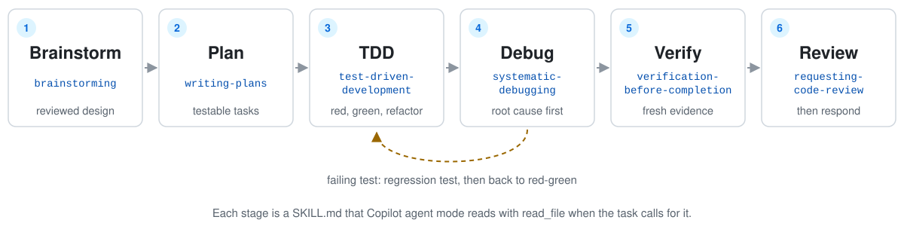
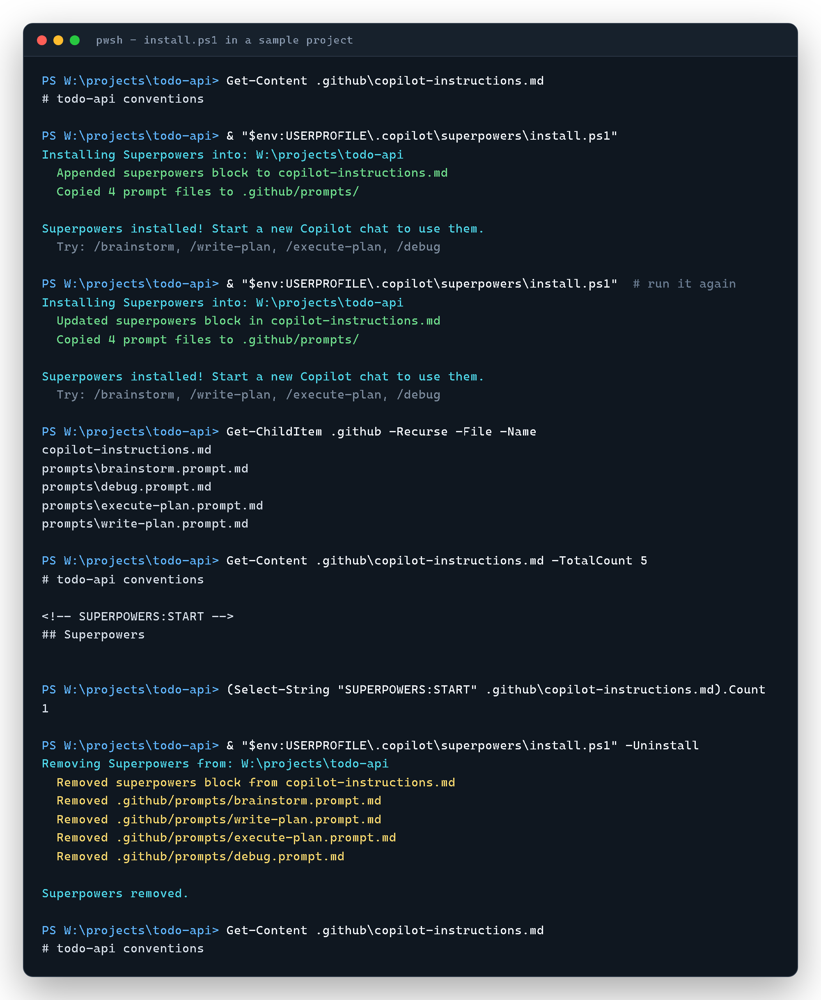
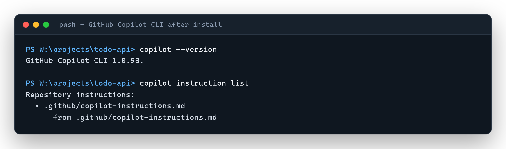
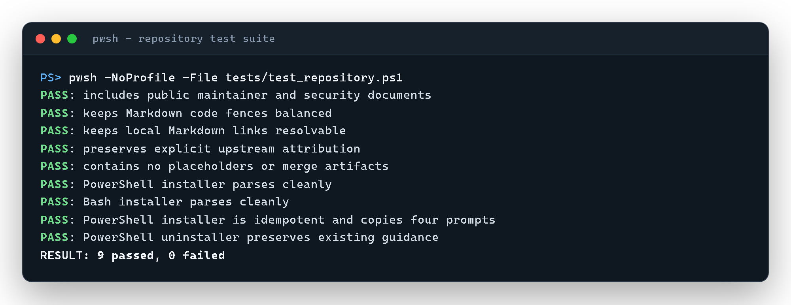

# Superpowers for GitHub Copilot

[](https://github.com/autovant/superpowers/actions/workflows/tests.yml)
[](LICENSE)
[](https://github.com/obra/superpowers)

Jesse Vincent's Superpowers skill library, installed into any project as GitHub Copilot custom instructions, so agent mode is told to brainstorm, plan, test first, debug, verify and ask for review before it calls work done.

This repository adds the Copilot layer: project-scoped installers for PowerShell and Bash, four Copilot prompt files, a Claude Code to Copilot tool-name mapping, and a CI test suite. The details are under [What's different from upstream](#whats-different-from-upstream).

> **Credit.** The workflow and the skills are the work of [Jesse Vincent](https://github.com/obra) and the contributors to [obra/superpowers](https://github.com/obra/superpowers), released under the MIT license. This repository adapts that work for GitHub Copilot. It does not claim authorship of the upstream workflow or skills.

<picture>
  <source media="(prefers-color-scheme: dark)" srcset="docs/images/workflow-dark.svg">
  
</picture>

## What it does

- Ships the 14 upstream skills as plain `SKILL.md` files that Copilot agent mode reads with `read_file`.
- Installs per project: one marked block in `.github/copilot-instructions.md` plus four prompt files (`/brainstorm`, `/write-plan`, `/execute-plan`, `/debug`).
- Keeps the guidance a project already has in `.github/copilot-instructions.md`. Re-running the installer updates the block in place, and uninstall removes the block (trimming leading and trailing whitespace from what remains). Prompt files are ownership-aware: the installer records what it wrote in `.github/prompts/.superpowers-manifest` (SHA-256 per file). It never overwrites a same-named prompt it did not create, and uninstall deletes only prompts it installed and you have not edited. A prompt you changed after install is kept, and so is any prompt that differs from what was installed.
- Maps the Claude Code tool names the skills use (`Task`, `TodoWrite`, `Bash`, ...) to Copilot agent-mode tools.
- Runs a PowerShell test suite in CI on pushes to `main` and on pull requests.

It does not install VS Code, enable Copilot, change global Copilot settings, or run a skill by itself.

## Install

You need git, PowerShell 7 or Bash, and VS Code with GitHub Copilot Chat in agent mode. Clone once to the default location below, then run the installer from the root of each project that should use the skills.

**Windows (PowerShell 7)**

```powershell
git clone https://github.com/autovant/superpowers.git "$env:USERPROFILE\.copilot\superpowers"
Set-Location path\to\your-project
& "$env:USERPROFILE\.copilot\superpowers\install.ps1"
```

**macOS or Linux (Bash)**

```bash
git clone https://github.com/autovant/superpowers.git ~/.copilot/superpowers
cd path/to/your-project
~/.copilot/superpowers/install.sh
```

A real run in a sample project that already had its own instructions: install, re-install, then uninstall back to the original file.



Then start a new Copilot chat in VS Code agent mode and try `/brainstorm`, `/write-plan`, `/execute-plan` or `/debug`. The prompt files and the tool names below target VS Code agent mode. GitHub Copilot CLI also lists the instructions file as a repository instruction source:



To remove it from a project, run `install.ps1 -Uninstall` or `install.sh --uninstall`. The [installation guide](.copilot/INSTALL.md) covers manual setup, updating and verification, and the [Copilot usage guide](docs/README.copilot.md) covers troubleshooting.

## Skill catalogue

| Stage | Skill | Use it when |
| --- | --- | --- |
| Entry point | [`using-superpowers`](skills/using-superpowers/SKILL.md) | Starting any task. It tells the agent how to find and load the other skills. |
| Design | [`brainstorming`](skills/brainstorming/SKILL.md) | Before building anything. It turns a rough request into a reviewed design. |
| Isolation | [`using-git-worktrees`](skills/using-git-worktrees/SKILL.md) | Starting feature work that should not touch the current workspace. |
| Planning | [`writing-plans`](skills/writing-plans/SKILL.md) | You have a spec and need small, testable implementation tasks. |
| Execution | [`executing-plans`](skills/executing-plans/SKILL.md) | Working through a written plan task by task, in a separate session. |
| Execution | [`subagent-driven-development`](skills/subagent-driven-development/SKILL.md) | Running a plan's independent tasks through subagents, with review between tasks. |
| Execution | [`dispatching-parallel-agents`](skills/dispatching-parallel-agents/SKILL.md) | Two or more tasks have no shared state and can run in parallel. |
| Implementation | [`test-driven-development`](skills/test-driven-development/SKILL.md) | Writing any feature or bug fix. Test first, watch it fail, then make it pass. |
| Diagnosis | [`systematic-debugging`](skills/systematic-debugging/SKILL.md) | Any bug, test failure or unexpected behaviour, before proposing a fix. |
| Evidence | [`verification-before-completion`](skills/verification-before-completion/SKILL.md) | About to say something is done, fixed or passing. Run the check first. |
| Review | [`requesting-code-review`](skills/requesting-code-review/SKILL.md) | A task or feature is complete and needs review before merge. |
| Review | [`receiving-code-review`](skills/receiving-code-review/SKILL.md) | Acting on review feedback. Verify it before agreeing with it. |
| Delivery | [`finishing-a-development-branch`](skills/finishing-a-development-branch/SKILL.md) | Tests pass and you need to choose merge, PR or clean-up. |
| Meta | [`writing-skills`](skills/writing-skills/SKILL.md) | Creating or editing a skill and testing that it works. |

Tool names in the skill text are upstream's Claude Code names. Copilot uses these equivalents:

| Skill reference | Copilot equivalent |
| --- | --- |
| `Task` | `runSubagent` |
| `TodoWrite` | `manage_todo_list` |
| `Skill` | `read_file` on the relevant `SKILL.md` |
| `Read` | `read_file` |
| `Write` | `create_file` |
| `Edit` | `replace_string_in_file` or `multi_replace_string_in_file` |
| `Bash` | `run_in_terminal` |

Details and caveats are in [Copilot tools](skills/using-superpowers/references/copilot-tools.md).

## What's different from upstream

This repository started from upstream commit [`33e55e6`](https://github.com/obra/superpowers/commit/33e55e6) (March 2026): release [v5.0.0](https://github.com/obra/superpowers/releases/tag/v5.0.0) plus three commits that changed only upstream's README.

| | Change |
| --- | --- |
| Added | `install.ps1` and `install.sh`: project-scoped installers that manage a marked block and can uninstall cleanly. |
| Added | Four `.prompt.md` files for Copilot slash-command entry points. |
| Added | [`copilot-tools.md`](skills/using-superpowers/references/copilot-tools.md), the tool-name mapping, and a Copilot usage guide. |
| Added | A repository test suite and a CI workflow that runs it on Windows. |
| Changed | `using-superpowers/SKILL.md` loads skills with `read_file` and names Copilot instruction files instead of `CLAUDE.md`. |
| Unchanged | The other 13 skills' text is the same as upstream v5.0.0. |
| Removed | Plugin packaging for Claude Code, Cursor, Codex and OpenCode, the session-start hooks, upstream's slash commands and agent definition, `lib/` (including the brainstorm server), upstream's test harnesses, release notes and design plans. |

## Tests

```powershell
pwsh -NoProfile -File tests/test_repository.ps1
bash tests/test_install.sh
```

The suite checks required files; Markdown links, code fences and leftover placeholders in the five top-level docs; upstream attribution; both installers' syntax (the Bash check needs Git Bash on Windows and is skipped without it); and the PowerShell installer's install, re-install, uninstall and prompt-ownership behaviour in temporary projects. `tests/test_install.sh` runs the same lifecycle and ownership checks against `install.sh`. CI runs both on `windows-latest`; there is no macOS or Linux run.



## Limitations

- The skills are instructions, not enforcement. Whether Copilot follows them depends on the model, the tools agent mode exposes, workspace permissions and project context.
- Some skill text still uses Claude Code terms (for example "Task tool" or "Skill tool"). The installed block and the mapping above translate them; the skills themselves are kept close to upstream on purpose.
- The brainstorming skill's optional visual companion (`skills/brainstorming/visual-companion.md`) refers to a browser server under `lib/` that this adaptation does not ship, so that option does not work here.
- The installed block points at the clone's skill paths. Cloned anywhere other than `~/.copilot/superpowers`, it writes that machine's absolute path into the project's `.github/copilot-instructions.md`, and the prompt files still look in `~/.copilot/superpowers` or the workspace. Use the default location, especially if the file is committed for a team. Moving or deleting the clone breaks the paths until you re-run the installer.
- `requesting-code-review` asks for a named `superpowers:code-reviewer` subagent, whose upstream definition is not shipped here. In Copilot, fill the skill's [`code-reviewer.md`](skills/requesting-code-review/code-reviewer.md) template and pass it to a generic `runSubagent` call.
- Upstream has released newer versions since v5.0.0. Changes from them are not merged here yet.

## Contributing, security and license

See [CONTRIBUTING.md](CONTRIBUTING.md) and [SECURITY.md](SECURITY.md). Changes to an upstream skill's core behaviour are better proposed to [obra/superpowers](https://github.com/obra/superpowers) first.

MIT. The [LICENSE](LICENSE) file is upstream's, `Copyright (c) 2025 Jesse Vincent`, kept unchanged. Copilot-specific changes in this repository are released under the same license.
